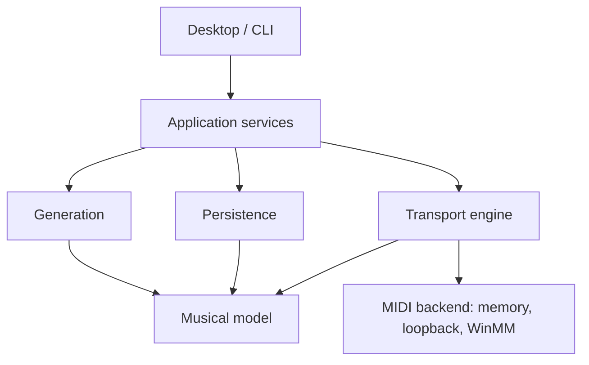

# Architecture

Use a modular .NET 10 application with a UI-independent musical model, deterministic planners, compiled playback plans, a dedicated transport owner, and replaceable MIDI adapters. Avalonia is the initial desktop frontend. Hardware MIDI integration is Windows-first; domain and planning code remain portable.

## Current project boundaries

| Project | Responsibility | References |
|---|---|---|
| Domain | Musical ticks, meter, outlines, projects, notes, routes, captures | BCL only |
| Generation | Deterministic section preparation and lock preservation | Domain |
| Engine | Tempo map, plan compilation, route resolution, transport, transport host, MIDI backend contract, memory/loopback endpoints, phrase recorder | Domain |
| Persistence | Validated JSON projects/rigs/takes, schema migration, MIDI file writer, atomic replacement | Domain |
| Application | Use cases and session lifetime; worker ownership | Domain, Generation, Engine, Persistence |
| Midi.Windows | WinMM output/input, endpoint polling, high-resolution wait | Engine |
| Desktop | Avalonia shell, Dock, outline/note/routing/perform controls, file pickers | Application, Midi.Windows |
| Cli | New, validate, upgrade, simulate, export, devices, probe | Application, Midi.Windows |
| Specs | Executable behavior specifications without test-framework packages | Application |

`IMidiBackend` enumerates endpoints and opens ports. An output port either accepts future timestamps and cancellation (`ScheduledSend`) or sends immediately, in which case the host holds each message until its deadline. WinMM is the immediate kind. Input callbacks only timestamp and enqueue.

## Thread ownership

`TransportHost` owns one worker thread, the `Transport`, the output ports in use, thru and the capture buffers. Commands (Start, Stop, Panic, tempo, arm) enter a bounded queue; each completes after its effect is published. Status is an immutable snapshot. Input arrives through a bounded queue from driver threads; overflow is counted. The capture is a preallocated array read only while stopped, guarded by a sequence counter.

`WorkbenchSession` owns project state, the rig and port lifetimes, and opens devices off the worker. It never shares a lock with the worker. Recording is converted to notes after Stop, off the worker. Generation and note edits still require Stop.

The worker wakes about every millisecond (high-resolution waitable timer on Windows, `Thread.Sleep` elsewhere) and schedules messages up to 10 ms ahead with absolute deadlines. The UI's 50 ms refresh never advances transport.

## Preparation and performance

1. Capture an outline/project revision and generator version.
2. Prepare candidate motifs, roles, fills and coordinated transitions away from the scheduler.
3. Validate bounds, pitch/range, ownership, routing and protected material.
4. Publish a candidate for audition, not directly into the accepted arrangement.
5. On commit, compile an immutable plan and activate it at a selected beat/bar/phrase boundary.
6. Preserve actual output and user actions independently of recipes.

Only steps 1–3 and stopped replacement are implemented; recorded phrases enter as locked notes after Stop. Candidate comparison and boundary activation are milestones. A late planner job must leave the current plan playing. Never recompute performed history as a side effect of changing a future section.

## Events and timing

Domain time uses signed 64-bit ticks at 960 PPQ; UI uses one-based MIDI channels and note numbers. Adapter boundaries convert channels to zero-based wire values. This resolution supports ordinary straight/triplet patterns; arbitrary tuplets may require rational positions in a later schema.

Events at the same musical time release a repeated pitch before its next attack. Ownership is tracked per resolved endpoint, channel and pitch: simultaneous owners share one sounding note, released after the last owner. Skipped late note-ons never acquire ownership. Destinations routed to the same endpoint share one clock stream.

Late note-ons and clock pulses (more than 25 ms) are skipped and counted; releases are always sent. A stall therefore never bursts a backlog into a device. Stop releases after messages already inside the lookahead; Panic cancels scheduled output, re-sends cancelled releases and sends All Notes Off on used channels. A failing output stops playback and releases the other outputs. These policies are provisional until measured on hardware.

## Persistence and recall

SongProject contains musical material and logical destination names. Rig (`LocalApplicationData/MidiWorkbench/rig.json`) resolves destinations to endpoints, optional channel overrides, per-endpoint clock and delay, and the recording input. Workspace contains docking only (`layout.json`). A song never stores an endpoint, route or transport state.

ProjectStore validates version and musical bounds, writes a temporary sibling and replaces the target. This prevents publishing partially serialized JSON; it is not a power-failure durability guarantee. Add migrations, backups, checksums and crash recovery before extensive capture workflows.

Capture is bounded and flags overflow. Takes keep inputs, outputs and the action journal separate and record submission or host-arrival times, not sound onset. Patterns carry recipe metadata (generator, version, random algorithm, seed, drummer settings).

## MusicSessionTrace integration

The drummer planners (`DrumPatternPlanner`, `PersonaDrumPlanner`, persona table) were ported into Generation, converted from sample frames to ticks and extended to arbitrary meters. A spec checks the port against a SHA-256 of the original output for 4/4, 3/4 and 6/8. `SessionBeatTimeline`, the adaptive followers, `GeneratedMidiHub` and the DryWetMidi-based I/O were not taken: they assume four beats, wall-clock seconds or a shared send lock. No shared package exists; MusicSessionTrace was not modified.
