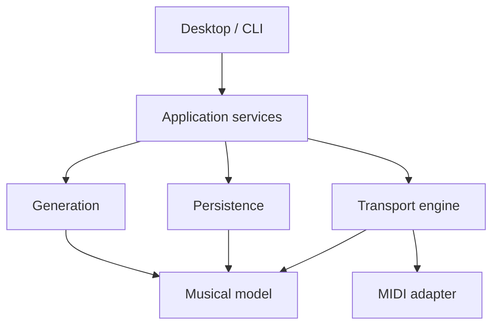

# Architecture

Use a modular .NET 10 application with a UI-independent musical model, deterministic planners, compiled playback plans, a dedicated transport owner, and replaceable MIDI adapters. Avalonia is the initial desktop frontend. Hardware MIDI integration is Windows-first; domain and planning code remain portable.

## Current project boundaries

| Project | Responsibility | References |
|---|---|---|
| Domain | Musical ticks, meter, outlines, projects, notes, routes, captures | BCL only |
| Generation | Deterministic section preparation and lock preservation | Domain |
| Engine | Tempo mapping, plan compilation, event ordering, transport, sink contract | Domain |
| Persistence | Validated JSON load/save and atomic replacement | Domain |
| Application | Use cases and session lifetime; worker ownership | Domain, Generation, Engine, Persistence |
| Desktop | Avalonia shell, Dock, outline/note controls, file pickers | Application and its public model dependencies |
| Cli | New, validate, deterministic simulation | Application |
| Specs | Executable behavior specifications without test-framework packages | Application |

The current IMidiSink implementation stores events in memory. Hardware discovery, timestamped submission and input capture are intentionally not faked.

## Thread ownership

Target: commands enter a bounded transport queue. One transport worker owns playback position, prepared-plan activation, note ownership and endpoint dispatch. Immutable status snapshots flow back to the UI. Planner jobs operate on versioned snapshots and return candidates. Persistence runs off the timing path. Native input callbacks only timestamp and enqueue.

Scaffold: WorkbenchSession serializes operations with a short lock and pumps a memory-only Transport on a dedicated task. A 2 ms wait is a demonstration driver, not a production scheduler. Generation is outside the lock and rejects concurrent replacement. Note editing and generation require stopped transport. This deliberate restriction precedes bounded command queues and boundary commits; do not market it as live orchestration yet.

The UI's 50 ms refresh never advances transport. TempoClock derives positions from monotonic host time instead of counting UI ticks. Playback is one-shot for the selected first section in this foundation.

## Preparation and performance

1. Capture an outline/project revision and generator version.
2. Prepare candidate motifs, roles, fills and coordinated transitions away from the scheduler.
3. Validate bounds, pitch/range, ownership, routing and protected material.
4. Publish a candidate for audition, not directly into the accepted arrangement.
5. On commit, compile an immutable plan and activate it at a selected beat/bar/phrase boundary.
6. Preserve actual output and user actions independently of recipes.

Only steps 1–3 and stopped replacement are implemented. Candidate comparison and boundary activation are milestones. A late planner job must leave the current plan playing. Never recompute performed history as a side effect of changing a future section.

## Events and timing

Domain time uses signed 64-bit ticks at 960 PPQ; UI uses one-based MIDI channels and note numbers. Adapter boundaries convert channels to zero-based wire values. This resolution supports ordinary straight/triplet patterns; arbitrary tuplets may require rational positions in a later schema.

Events at the same musical time release a repeated pitch before its next attack. The prototype groups simultaneous same-pitch owners into one held note and only releases the final owner. Production must expose retrigger/merge policies; MIDI 1.0 cannot identify voices sharing a channel and pitch. Skipped late note-ons never acquire ownership.

The prototype skips note-ons more than 25 ms late and limits clock catch-up. These are provisional simulation choices. Hardware operation must use measured, configurable late-event/lost-clock policies and report faults; silently skipping synchronization pulses is not a complete production policy.

## Persistence and recall

SongProject contains musical material and logical destination names. Rig resolves destinations to hardware endpoints. Workspace contains docking only and lives under LocalApplicationData/MidiWorkbench/layout.json. A song never stores a live endpoint object or transport thread.

ProjectStore validates version and musical bounds, writes a temporary sibling and replaces the target. This prevents publishing partially serialized JSON; it is not a power-failure durability guarantee. Add migrations, backups, checksums and crash recovery before extensive capture workflows.

Capture is bounded and flags overflow. JSON records actual submitted event times, not physical sound onset. Musical recipes and MIDI captures need generator version, seed and performance journal for repeatability; these metadata extensions are specified in project-model.md.

## MusicSessionTrace integration

Inspected on 2026-11-04: SessionBeatTimeline, SessionClock, BeatPulseIndicator, GeneratedMidiHub, LiveMidiClock, DockWorkspace, synth-player and adaptive-drums docs.

Reuse candidates: pure drummer/persona planning, synth role logic, MIDI codecs/export, channel ownership concepts and timing diagnostics. Assess dependencies and tests before moving source into a shared package. Do not import ASIO, audio transcription, voice capture or the whole application shell.

Observed constraints: BeatPulseIndicator/BeatPulseFrame assume four beats. GeneratedMidiHub serializes sends under a common lock; it is not a priority scheduler and its realtime lease API only accepts F8/FA/FC. Existing synth docs defer meter/swing alignment and full traffic scheduling. These are reasons for explicit new abstractions rather than wholesale copying.

No shared package or cross-repository modification has been made in this scaffold.
